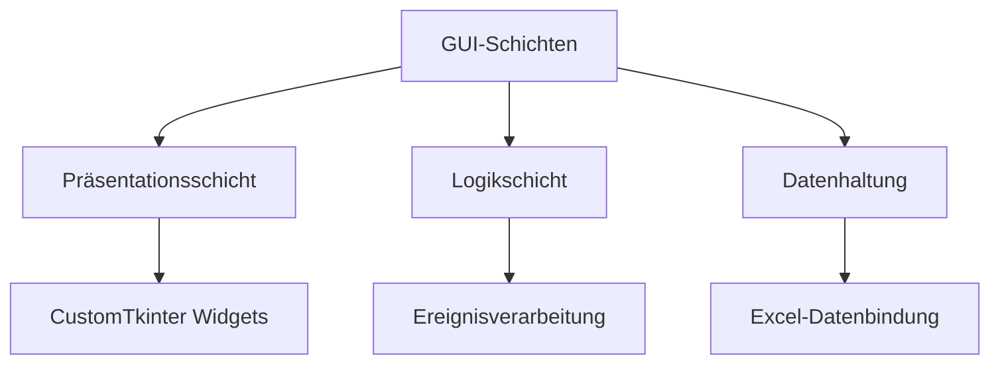
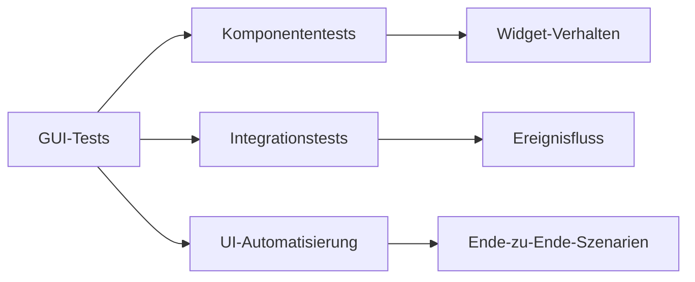

# Entwickleranleitung: GUI-Implementierung Wasserski-Racing Zeitnehmung

## Architekturprinzipien


## Kernkomponenten-Übersicht
| Komponente          | Technologie       | Verantwortlichkeit               |
|---------------------|-------------------|----------------------------------|
| Fenster-Manager      | CustomTkinter     | Hauptfenster-Layout              |
| Dashboard-Renderer   | CTkFrame          | Renninfo & Countdown-Anzeige     |
| Live-Tabelle         | CTkTreeview       | Echtzeit-Rangliste               |
| Hotkey-System        | Keyboard-Modul    | Tastaturereignisverarbeitung     |
| Log-Manager          | Loguru + Custom   | Protokollierung & Rotation       |

## GUI-Implementierungsdetails

### 1. Fensterstruktur
```python
import customtkinter as ctk

class MainWindow(ctk.CTk):
    def __init__(self):
        super().__init__()
        self.title("Wasserski-Racing Timing System v1.0")
        self.configure_theme("dark-blue")
        
        # Vier Hauptbereiche
        self.header = HeaderFrame(self)
        self.dashboard = DashboardFrame(self)
        self.main_area = MainAreaFrame(self)
        self.footer = FooterFrame(self)
        
        # Layout mit Grid-Manager
        self.header.grid(row=0, column=0, sticky="nsew")
        self.dashboard.grid(row=1, column=0, sticky="nsew")
        self.main_area.grid(row=2, column=0, sticky="nsew")
        self.footer.grid(row=3, column=0, sticky="nsew")
```

### 2. Farb- und Stilkonfiguration
```python
# colors.py
COLOR_SCHEME = {
    "bg": "#121212",
    "panel": "#1e1e1e",
    "accent_green": "#00c853",
    "accent_red": "#ff1744",
    "accent_blue": "#2979ff",
    "accent_yellow": "#ffd600",
    "text_primary": "#ffffff"
}

# fonts.py
FONT_MAPPING = {
    "header": ("Roboto Bold", 24),
    "dashboard_title": ("Roboto Medium", 16),
    "countdown": ("Roboto Mono", 32),
    "table_header": ("Roboto Medium", 12),
    "table_row": ("Roboto", 11)
}
```

### 3. Ereignisverarbeitungssystem
```python
# event_system.py
class EventDispatcher:
    def __init__(self):
        self.handlers = {}
        
    def register(self, event_type, handler):
        if event_type not in self.handlers:
            self.handlers[event_type] = []
        self.handlers[event_type].append(handler)
    
    def dispatch(self, event):
        event_type = event['type']
        if event_type in self.handlers:
            for handler in self.handlers[event_type]:
                handler(event)

# Kernereignistypen
EVENT_TYPES = [
    "RACE_START",
    "BOOT_PASSAGE",
    "MANUAL_CORRECTION",
    "RACE_END",
    "COUNTDOWN_UPDATE"
]
```

### 4. Hotkey-Integration
```python
# hotkey_manager.py
import keyboard

class HotkeyManager:
    def __init__(self, event_dispatcher):
        self.event_dispatcher = event_dispatcher
        self.boot_mapping = self.load_boot_mapping()
        
    def load_boot_mapping(self):
        # Lädt Boot-Key-Zuordnung aus Excel
        return {'1': 'Boot A', '2': 'Boot B', ...}
    
    def start_listening(self):
        for key in self.boot_mapping.keys():
            keyboard.on_press_key(key, self.handle_boot_event)
        
    def handle_boot_event(self, event):
        boot_id = self.boot_mapping[event.name]
        self.event_dispatcher.dispatch({
            'type': 'BOOT_PASSAGE',
            'boot': boot_id,
            'timestamp': time.time()
        })
```

## Performance-Critical Sections
1. **Echtzeit-Tabellenaktualisierung**:
   - Verwendung von Double Buffering
   - Incrementelle Updates statt vollständigem Redraw
   - Thread-Safe Operationen mit Queue

2. **Logging-Overhead**:
   - Asynchrone Protokollierung
   - Batch-Schreiben bei hoher Last
   - Separater Logger-Thread

3. **Countdown-Präzision**:
   - Systemzeit-basierte Berechnung
   - Unabhängig von GUI-Refresh-Rate
   - Hardware-Timer bei verfügbarer Unterstützung

## Teststrategie


## Best Practices für Entwickler
1. **Theming-Konsistenz**:
   - Ausschließliche Verwendung der zentralen `colors.py`
   - Nutzung der Font-Mappings für Textkonsistenz

2. **Threading**:
   - Keine direkten GUI-Updates aus Hintergrundthreads
   - Verwendung von `after()` für threadübergreifende Updates

3. **Internationalisierung**:
   - String-Externalisierung mit Platzhaltern
   - Berücksichtigung von Textlängenänderungen

4. **Barrierefreiheit**:
   - Kontrastverhältnis min. 4.5:1
   - Tastaturnavigation unterstützen
   - Screenreader-Kompatibilität

## Wartung & Erweiterbarkeit
1. **Konfigurationszentralisierung**:
   - Alle layoutbezogenen Parameter in `layout_config.py`
   - Verhaltensparameter in `app_config.py`

2. **Modulare Architektur**:
   - Klare Trennung View/Logik
   - Dependency Injection für Service-Komponenten

3. **Dokumentationspflicht**:
   - Docstrings für öffentliche Methoden
   - Architecture Decision Records (ADRs) für wesentliche Änderungen