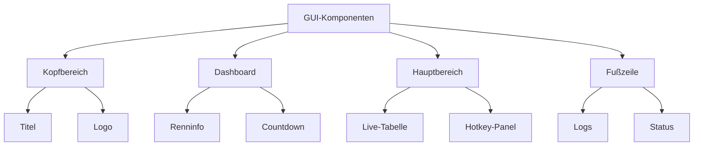
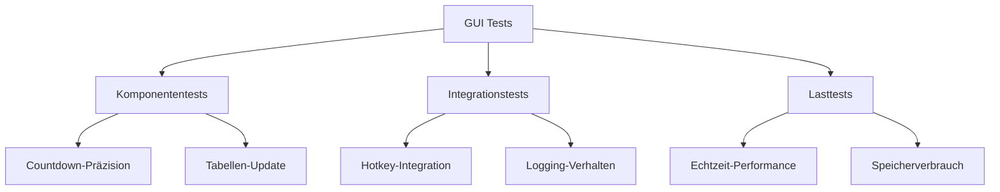

# GUI Implementierungsleitfaden für Entwickler

## 1. Architekturübersicht


## 2. Farbpalette & Stil
| Bereich | Farbe (HEX) | Verwendung |
|---------|-------------|------------|
| Hintergrund | `#121212` | Hauptfensterhintergrund |
| Panel | `#1E1E1E` | Container-Hintergründe |
| Akzent 1 | `#00C853` | Positive Aktionen, Führender |
| Akzent 2 | `#FF1744` | Rennstart, Warnungen |
| Akzent 3 | `#2979FF` | Fortschrittsbalken |
| Text | `#FFFFFF` | Primäre Schriftfarbe | 

```python
# Stilkonfiguration in colors.py
THEME = {
    'header_bg': '#121212',
    'panel_bg': '#1E1E1E',
    'success': '#00C853',
    'warning': '#FFD600',
    'error': '#FF1744',
    'text_primary': '#FFFFFF',
    'text_secondary': '#B0BEC5'
}
```

## 3. Kernkomponenten-Implementierung

### 3.1 Live-Tabelle
```python
class LiveTable(ctk.CTkFrame):
    def __init__(self, parent):
        super().__init__(parent)
        self.columns = ['#', 'Runner', 'Klasse', 'Boot', 'Runden', 'Letzte Runde', 'Gesamtzeit']
        self.tree = ttk.Treeview(self, columns=self.columns, show='headings')
        
        # Spaltenkonfiguration
        self.tree.heading('#', text='Platz')
        self.tree.column('#', width=50, anchor='center')
        self.tree.heading('Runner', text='Fahrer')
        self.tree.column('Runner', width=150)
        
        # Highlighting für Führenden
        self.tree.tag_configure('leader', background='#00C85320', foreground='white')
```

### 3.2 Countdown-System
```python
class CountdownManager:
    def __init__(self):
        self.timers = {
            'vorstart': {
                'duration': 300,  # 5 Minuten
                'label': 'VORSTART:',
                'color': '#FF1744'
            },
            'renndauer': {
                'duration': 1800,  # 30 Minuten
                'label': 'VERBLEIBENDE ZEIT:',
                'color': '#00C853'
            }
        }
    
    def start_countdown(self, timer_type):
        self.active_timer = self.timers[timer_type]
        self.start_time = time.time()
        self.update_display()
    
    def update_display(self):
        elapsed = time.time() - self.start_time
        remaining = self.active_timer['duration'] - elapsed
        mins, secs = divmod(remaining, 60)
        return f"{mins:02.0f}:{secs:02.0f}"
```

## 4. Hotkey-Integration
```python
HOTKEY_MAPPING = {
    '1': 'Boot A',
    '2': 'Boot B',
    '3': 'Boot C',
    'space': 'Manuelle Korrektur',
    'enter': 'Rennstart'
}

def handle_hotkey(event):
    key = event.keysym
    if key in HOTKEY_MAPPING:
        log_event('Hotkey', f"{HOTKEY_MAPPING[key]} pressed")
        process_input(HOTKEY_MAPPING[key])
```

## 5. Logging-Integration
```python
def log_event(source, message, level='INFO'):
    entry = {
        'timestamp': datetime.now().isoformat(),
        'source': source,
        'level': level,
        'message': message
    }
    
    # Schreibeintrag in current.log
    with open('current.log', 'a') as f:
        f.write(json.dumps(entry) + '\n')
    
    # Fehler protokollieren
    if level in ['ERROR', 'CRITICAL']:
        with open('error.log', 'a') as f:
            f.write(json.dumps(entry) + '\n')
```

## 6. Performance-Optimierungen

### 6.1 Echtzeit-Updates
```python
def update_ui():
    # Batch-Update alle 100ms
    while True:
        if not update_queue.empty():
            updates = []
            while not update_queue.empty():
                updates.append(update_queue.get())
            
            # Bulk-Update der Tabelle
            update_table(updates)
        
        time.sleep(0.1)
```

### 6.2 Thread Management
```python
class AppThread(Thread):
    def __init__(self, target):
        super().__init__(daemon=True)
        self.target = target
    
    def run(self):
        try:
            self.target()
        except Exception as e:
            log_event('System', str(e), 'ERROR')

# Thread-Pool initialisieren
thread_pool = {
    'ui_updates': AppThread(target=update_ui),
    'logging': AppThread(target=log_manager)
}
```

## 7. Teststrategie


## 8. Best Practices
1. **Zustandsmanagement**
   - Zentrale State-Klasse für Renninformationen
   - Observer-Pattern für UI-Updates

2. **Fehlerbehandlung**
   - Globaler Error-Handler
   - Graceful Degradation bei kritischen Fehlern

3. **Dokumentation**
   - Typ-Hints für alle öffentlichen Methoden
   - Beispielcode für Erweiterungen

4. **Performance**
   - Vermeidung von Blocking-Operations
   - Caching häufig genutzter Daten